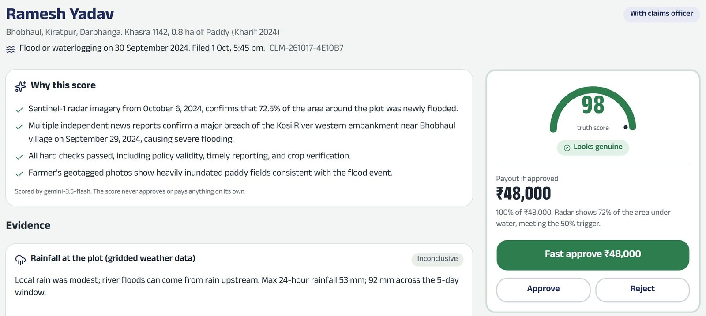
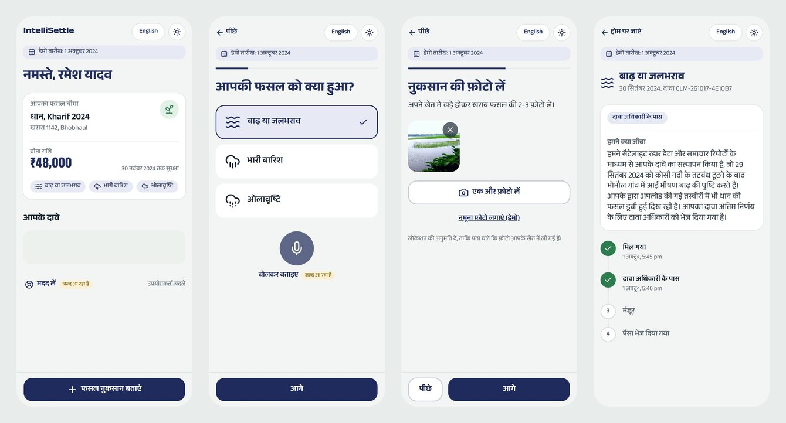
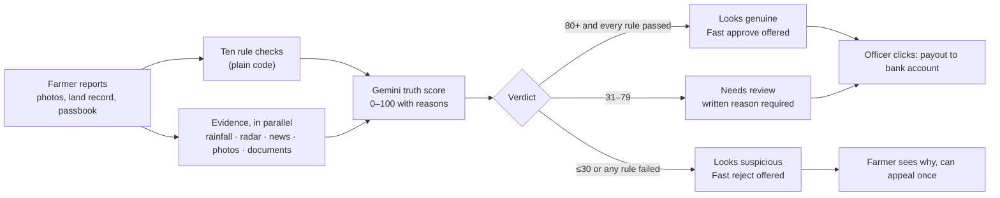
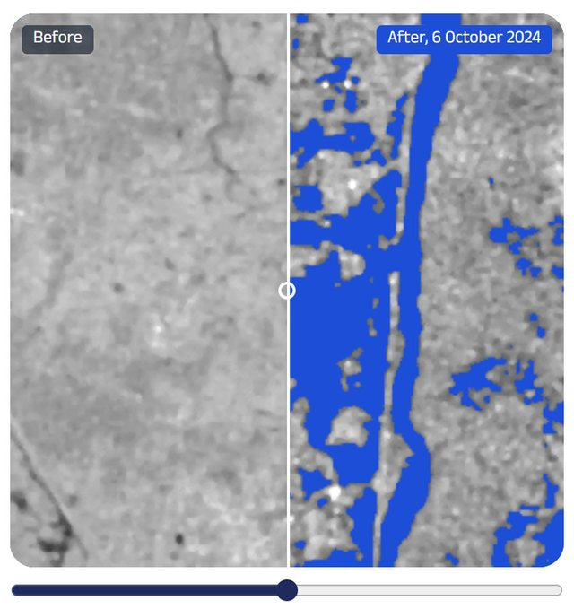
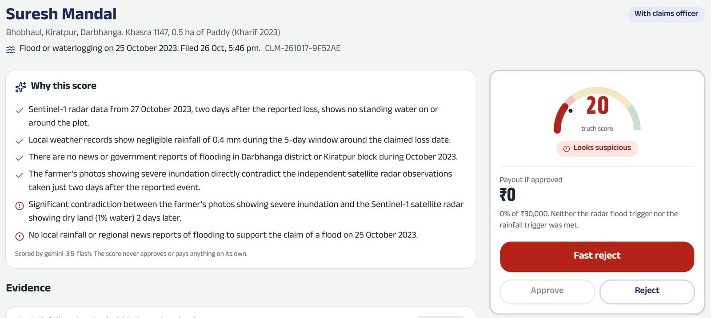
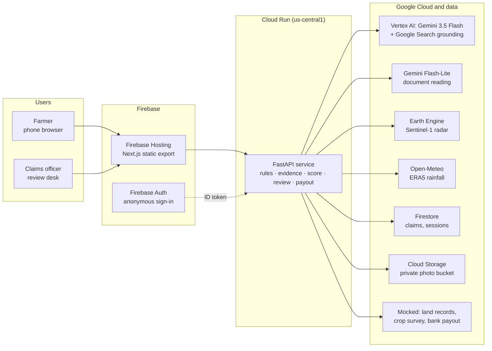

# IntelliSettle

**AI-verified crop insurance claims for India’s smallholder farmers.** A farmer reports a crop loss from the field in Hindi. In about a minute, IntelliSettle checks the claim against evidence the farmer cannot fake, and a claims officer approves clear claims in one click.

Built for the **Google Cloud AI Builder Cup 2026**, BFSI track: *Intelligent Risk, Fraud & Financial Experiences*.

**[Live demo](https://insurance-crisis.web.app)** · **[Demo video (3 min)](https://drive.google.com/file/d/1dkT8_0-YU8SANGgvYtRB1axn0jXxO9-G/view)** · **Team:** Crisis



---

## The problem

Crop insurance claims can take months. Each loss is established by field surveys, by checking handwritten land records and bank passbooks one by one, and by weather stations that can be many kilometres from the farm. For a smallholder on less than two hectares, a late payout means borrowing for the next sowing. Weak checks also let fake claims through.

## What IntelliSettle does

1. **The farmer reports from the field.** Five guided steps on a phone, Hindi first: what happened, when, photos of the damage (with GPS and time), the land record and the bank passbook.
2. **AI checks the evidence.** Rainfall at the exact plot, Sentinel-1 satellite radar, local news, and the farmer’s photos and documents, plus ten fixed rule checks. Gemini turns it all into a **truth score from 0 to 100 with reasons**.
3. **A person decides.** The claims officer sees the evidence and the score. Clear claims get **Fast approve**, suspicious ones get **Fast reject**, and everything else gets a full review. The AI never pays on its own.



## Try it in two minutes

1. Open **https://insurance-crisis.web.app** and pick a demo farmer. Ramesh Yadav is the Kosi flood case.
2. Tap **फसल नुकसान बताएं** (Report crop loss), choose the damage and the date, and use **sample photos** on the photo step.
3. Send the claim. The status screen explains, in Hindi, what was checked.
4. Go back to the start page and open the **review desk** to see the score, the evidence and the decision buttons.

Each browser gets its own private demo sandbox, so visitors never see each other’s claims. **Start the demo over** on the start page clears yours. Try Suresh Mandal for the fake claim.

## How a claim is checked



| Evidence | What it checks | How |
|---|---|---|
| Rainfall at the plot | Rain in the days around the loss, at the farm’s own coordinates | ERA5 gridded reanalysis via Open-Meteo |
| Satellite radar | Standing water before and after the loss, seen through cloud | Copernicus Sentinel-1 on **Google Earth Engine** |
| News and bulletins | Reports of the event in the same block and dates | **Gemini with Google Search grounding** |
| Photos | Whether the photos show the claimed damage, and look like the region | **Gemini** vision |
| Documents | Owner, area, IFSC and account details from handwritten Hindi papers | **Gemini Flash-Lite**, checked against records |

**Rule checks** (any failure means *Looks suspicious*): the peril is covered, the policy is active on the loss date, the loss was reported within 72 hours, the land record matches the owner and area, the crop survey matches the insured crop, at least one photo was taken within 1 km of the plot and after the loss, there is no duplicate claim, no photo is reused, and the documents match bank and land records.

**Safety rules:**
- The payout amount is computed by code from the policy terms, never by the AI.
- Fast approve needs every rule to pass, an independent source confirming the event, and a real AI score rather than the fallback.
- If a source is down, it is marked unavailable and the claim goes to a person. If Gemini is down, a rule-based score takes over and never unlocks Fast approve.
- Rain alerts only notify the farmer. The AI never files a claim.

<p>
  
</p>

## Results on real events

Every demo farmer is fictional, but their plot, the weather, the radar and the news are real.

| Claim | What the evidence showed | AI score | Verdict | Payout |
|---|---|---|---|---|
| Flood, Darbhanga, 30 Sep 2024 (Kosi embankment breach) | Radar: 72% of the area newly under water. News confirms the breach. | 98 | Looks genuine | ₹48,000 |
| Heavy rain, Araria, 19 Oct 2021 | 220 mm in 24 hours at the plot. Radar shows ponding. | 98 | Looks genuine | ₹72,000 |
| Hailstorm, Araria, 20 Mar 2026 | Sudden storm burst after dry days. Hail reported locally. | 95 | Looks genuine | ₹15,000 |
| Flood claimed, Darbhanga, 25 Oct 2023 (fake) | Radar: dry field. Almost no rain. No news. Paperwork looked fine. | 15 | Looks suspicious | ₹0 |

These are live runs on the deployed system (Cloud Run, Gemini 3.5 Flash on Vertex AI), on 17 October 2026. The fake claim scored between 15 and 20 across repeated runs, always well below the reject line of 30. A claim goes from **Send** to a scored verdict in under a minute.



## Architecture



- **Google Cloud and Firebase:** Vertex AI (Gemini), Google Search grounding, Earth Engine, Cloud Run, Firebase Hosting, Firebase Authentication, Firestore and Cloud Storage.
- **No keys in the cloud:** Gemini runs through the Cloud Run service account.
- **Backend:** Python 3.12, FastAPI, Pydantic, uv.
- **Frontend:** Next.js 16 (static export), React 19, Tailwind CSS 4, shadcn/ui, SWR, and the Anek Devanagari font for Hindi.

## Built to grow beyond crops

Each insurance product is a plug-in. A product subclasses `InsuranceProduct` (`api/src/claims_api/products/base.py`) and defines four things: its evidence plan, its rule checks, its payout formula and its scoring guidance. It is then registered in `products/registry.py`.

Scoring, verdicts, the review desk, appeals and payouts are shared. Crop is product one; livestock, health, motor and property cover can follow without rebuilding the pipeline.

## Repository layout

```
api/                  FastAPI service (Python 3.12, uv)
  src/claims_api/
    products/         insurance products (crop is the first plug-in)
    engine/           evidence pipeline, truth scoring, verdicts
    evidence/         rainfall, Sentinel-1 radar, news, photo checks
    ai/               Gemini client and document reader
    services/         claims lifecycle, sessions, payouts, alerts
    store/            in-memory and Firestore storage
  tests/              unit tests and demo scenarios, with recorded real responses
web/                  Next.js app: farmer app (/farmer) and review desk (/review)
data/seed/            demo farmers, policies, land records, scenarios
docs/                 decisions, setup guide, research on the demo events
scripts/              deploy, smoke test, demo document and photo tools
Dockerfile            API container (built by Cloud Build)
```

## Run it locally

You need [uv](https://docs.astral.sh/uv/) and Node.js 20.9 or later.

**API** (http://localhost:8080):

```bash
cp api/.env.example api/.env
```

```bash
cd api && uv run uvicorn claims_api.main:app --port 8080 --reload
```

In `api/.env`:
- `AUTH_MODE=dev` and `STORAGE_BACKEND=memory` need no cloud setup.
- For live AI, set `GEMINI_API_KEY` (a free AI Studio key) or set `GCP_PROJECT` to use Vertex AI.
- With neither, the rule-based fallback score is used and Fast approve stays off.
- The radar check needs `gcloud auth application-default login` on a project registered for Earth Engine.

**Web** (http://localhost:3000):

```bash
cp web/.env.example web/.env.local
```

```bash
cd web && npm install && npm run dev
```

## Tests

```bash
cd api && uv run pytest
```

The suite covers the rules, the payout formula, verdicts, the review flow and the API. The four demo scenarios run on **recorded real responses** (rainfall, radar and Gemini), so they are repeatable offline. Use `--record` to fetch and save any missing responses, or `--refresh` to re-record all of them. Currently 56 tests pass; the 4 full-AI scenario tests are skipped until their news responses are recorded.

## Deploy

```bash
gcloud run deploy intellisettle-api --source . --region us-central1 --env-vars-file deploy/api.env.yaml --max-instances 2 --no-cpu-throttling --cpu-boost --memory 1Gi --allow-unauthenticated
```

```bash
cd web && npm run build
```

```bash
uv run --project api python scripts/deploy_hosting.py
```

For the web build, put the production API URL and the Firebase web config in `web/.env.production.local`. The build step also copies Next.js segment files to the paths the router requests, so in-app navigation works on Firebase Hosting.

To check production end to end before a demo, run the smoke test for a real flood and for the fake claim:

```bash
uv run --project api python scripts/smoke_prod.py F-101
```

```bash
uv run --project api python scripts/smoke_prod.py F-104
```

## What is real and what is simulated

| Real | Simulated |
|---|---|
| Plots, rainfall, Sentinel-1 radar and news for each demo event | Demo farmers, with fictional names and banks |
| Gemini scoring, photo checks and document reading | Land records and bank passbooks (sample documents, marked as such) |
| The full claim lifecycle, review and audit trail | Government systems (land records, crop survey) and DBT payouts |

## Roadmap

- **Channels:** a WhatsApp bot, Hindi voice input (shown as "coming soon" in the app), and SMS or IVR for feature phones.
- **Languages:** Marathi, Tamil, Telugu, Bengali and Gujarati.
- **Integrations:** live connections to AgriStack, state land records (Bhulekh), the National Crop Insurance Portal, WINDS weather stations, and DBT or UPI payouts.
- **Products:** livestock, health, motor, property, and weather cover for small businesses.

## Credits

Demo photos come from Wikimedia Commons under their free licences, rainfall data from Open-Meteo (ERA5, CC BY 4.0), and radar is modified Copernicus Sentinel-1 data processed with Google Earth Engine. See [CREDITS.md](CREDITS.md) for full attribution.
